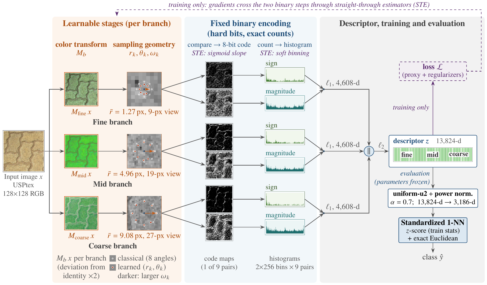

# FLEX-LBP

A PyTorch layer for **learnable local binary patterns with exact binary inference**. It implements the method of the
paper *FLEX-LBP: Learning Local Binary Patterns with Exact Binary Inference for Texture Classification* (see
[Paper](#paper)).



*Overview of FLEX-LBP (Fig. 1 of the paper). Each of the three branches learns its own color transform and sampling
geometry (radii, angles and thresholds). The binary encoding stays fixed, with hard comparisons and exact histogram
counts. During training, straight-through estimators (STE) carry the gradients across the two binary steps. For
evaluation, the descriptor is postprocessed and classified by standardized 1-NN. Input texture from USPtex (Backes et
al., 2012).*

FLEX-LBP keeps the LBP operator, which is binary codes and histograms, and learns its design choices by
backpropagation. These choices are the color transform, sampling radii, sampling angles, comparison thresholds and
gray-level quantization. The forward pass always computes hard comparisons and exact histogram counts. Surrogate
gradients (straight-through estimators) act only in the backward pass, so the descriptor you train is the descriptor
you deploy. The whole layer has 90 parameters, and each one has a geometric or photometric meaning that you can read
directly.

- **Drop-in layer:** `(B, 3, H, W)` RGB images in [0, 1] → `(B, 13824)` descriptors, differentiable end to end.
- **Exact inference:** the forward value is the exact histogram of the hard codes, during training too.
- **Interpretable:** `parameters_summary()` returns the learned radii, angles (in degrees), thresholds and color
  transforms of each branch.
- **Presets** for every configuration of the paper, from the hand-crafted operator (`fixed`) to the fully learned
  descriptor (`all_joint`, which learns everything except the quantization).

## Paper

*FLEX-LBP: Learning Local Binary Patterns with Exact Binary Inference for Texture Classification*, under review.
This anonymized copy of the code accompanies the submission. The citation will be added on publication.

## Installation

```bash
pip install .              # requires Python >= 3.9 and PyTorch >= 1.13 (tested with Python 3.10 and PyTorch 2.6)
pip install ".[lda]"      # adds scikit-learn for the shrinkage LDA readout
pip install ".[convert]"  # adds PyYAML, only needed to load research checkpoints
```

## Quick start

```python
import torch
from flexlbp import FLEXLBP

layer = FLEXLBP(template="wide", learn="geometry")   # learns radii, angles and thresholds (60 of the 90 parameters)
x = torch.rand(8, 3, 128, 128)                      # RGB in [0, 1]
z = layer(x)                                        # (8, 13824): l1 per branch, then l2-normalized
z.sum().backward()                                  # surrogate gradients reach the learned parameters
```

## Training and evaluation with the paper's recipe

`flexlbp.train.fit` follows the paper's recipe:

- Adam with component-specific learning rates: radii 2e-3; color transforms, angles and class proxies 1e-3;
  thresholds and quantization 5e-4.
- One step decay of the learning rates.
- No data augmentation.
- The checkpoint is selected by standardized 1-NN accuracy on a 15% stratified holdout of the training images.

The loss is a cosine proxy loss with an additive margin, plus mild geometry and threshold regularizers. For
evaluation, the descriptors are projected onto uniform patterns, power-normalized and classified by standardized 1-NN
(the paper's main readout) or by shrinkage LDA (its second readout).

```python
import torch
from flexlbp import FLEXLBP, postprocess, shrinkage_lda, standardized_1nn
from flexlbp.train import fit

torch.manual_seed(42)                                # the color transforms start at I + 0.01 N(0, 1)
layer = FLEXLBP(template="wide", learn="geometry")
layer, history = fit(layer, train_images, train_labels, epochs=8, batch_size=8)

train_desc = postprocess(layer.describe(train_images))   # (N, 3186)
test_desc = postprocess(layer.describe(test_images))
pred = standardized_1nn(train_desc, train_labels, test_desc)
pred_lda = shrinkage_lda(train_desc, train_labels, test_desc)   # needs scikit-learn
print(layer.parameters_summary())                         # the learned parameters
```

`examples/train_folder.py` runs the same pipeline on a folder of images (one subfolder per class). It also needs
NumPy and Pillow. Install the package first (`pip install .`), or run it from the repository root with `PYTHONPATH=.`.

## Configurations

| `learn=`    | Learned parameter groups                    | Learned parameters |
|-------------|---------------------------------------------|-------------------:|
| `fixed`     | none (the hand-crafted operator)            | 0                  |
| `color`     | 3×3 color transforms                        | 27                 |
| `radius`    | radii                                       | 12                 |
| `threshold` | comparison thresholds                       | 24                 |
| `geometry`  | radii, angles, thresholds                   | 60                 |
| `mixer_q`   | color transforms, quantization              | 30                 |
| `all_joint` | color transforms, radii, angles, thresholds | 87                 |

You can also pass any iterable of the groups `color`, `radius`, `angles`, `threshold` and `quantization`. The
parameters outside the chosen groups stay frozen at their initialization. `layer.set_learnable(groups)` changes the
groups after construction.

Radius templates, given as (initial radius, lower bound, upper bound) for the fine, mid and coarse branches:

| `template=` | fine         | mid          | coarse          |
|-------------|--------------|--------------|-----------------|
| `wide`      | 2 in [1, 3]  | 6 in [4, 8]  | 10 in [7, 13]   |
| `compact`   | 2 in [1.5, 4]| 5 in [3.5, 7]| 8 in [6.5, 10.5]|
| `compact_parquet` | 2 in [1, 3] | 5 in [3.5, 7] | 8 in [6, 10] |

A dict `{branch: (init, min, max)}` gives any other template.

Other options:

- `support_size=3` compares 3×3 medians instead of single pixels. This is one of the paper's two remedies for additive
  noise (the other is a 3×3 median-filtered input); both are applied at inference, without retraining.
- `histogram_estimator="bitflip"` selects the bit-aware (bit-flip) surrogate gradient that the paper compares with
  its adjacent-bin estimator.
- `input_quantization=False` removes the gray-level quantization step.

## Descriptor layout

Each of the three branches (fine, mid, coarse) applies its own color transform. It then computes 8-neighbor
sign and magnitude codes on the nine channel pairs (center channel i, neighbor channel j), in the order RR, RG, RB,
GR, GG, GB, BR, BG, BB. Like opponent color LBP, it compares channels with each other, but it keeps both orderings
of each pair. Each code histogram has 256 bins. The index of bin `code` of
component `c` (0 = sign, 1 = magnitude) for pair `p` in branch `b` is

    ((b * 9 + p) * 2 + c) * 256 + code

`flexlbp.uniform_u2` maps every 256-bin histogram to 59 bins: the 58 uniform patterns, then one bin for all
non-uniform codes. This reduces the descriptor to 3,186 dimensions.

## Using FLEX-LBP inside a network

```python
import torch.nn as nn
from flexlbp import FLEXLBP

class TextureNet(nn.Module):
    def __init__(self, num_classes):
        super().__init__()
        self.lbp = FLEXLBP(learn="all_joint")
        self.head = nn.Linear(self.lbp.dim, num_classes)

    def forward(self, x):
        return self.head(self.lbp(x))
```

Train on the raw descriptor, as the paper does. `postprocess` is meant for evaluation only: the power
normalization has an infinite derivative at empty histogram bins.

## Reproducing the paper

What the package provides:

- **The seven configurations of the paper** as presets of one layer: Fixed (`fixed`, 0 learned parameters), Color
  (`color`, 27), Radius (`radius`, 12), Threshold (`threshold`, 24), Geometry (`geometry`, 60), Mixer+Q (`mixer_q`,
  30) and All joint (`all_joint`, 87). Every preset stores the same 90 parameters, 30 per branch (4 basis radii,
  8 angle logits, 8 thresholds, a 3×3 color transform and the number of gray levels), and freezes the ones it does
  not learn. Mixer+Q starts its quantization at 128 gray levels; the other presets keep 256.
- **The training recipe** (`flexlbp.train.fit`, `flexlbp.losses`): the cosine proxy loss with an additive margin
  (scale 20, margin 0.1), the geometry and threshold regularizers (weights 0.01 and 0.001, each active only when its
  parameters are learned), Adam with the learning rates above and weight decay 1e-4 on the color transforms and
  proxies only, one step decay that halves the rates (after 6, 8 or 12 epochs for 8-, 12- or 20-epoch runs), no data
  augmentation, and checkpoint selection by standardized 1-NN accuracy on a 15% stratified holdout of the training
  images, from the first epoch on.
- **The evaluation pipeline:** `postprocess` (uniform-u2 projection, 13,824 → 3,186 dimensions, then power
  normalization with alpha = 0.7 and l2 normalization) and the two readouts of the paper: `standardized_1nn` (z-scoring
  with the training statistics, then exact Euclidean nearest neighbor) and `shrinkage_lda` (z-scoring, then
  scikit-learn's `LinearDiscriminantAnalysis(solver="lsqr", shrinkage="auto")`).
- **Tests against the research code** (`tests/test_reproduction.py`, see [Tests](#tests)). They load six trained
  checkpoints of the paper with `flexlbp.convert`, check that the layer gives the descriptors and parameter gradients
  of the research implementation, and recompute one reported accuracy from the images. They need the research
  checkpoints, which are not part of this package, and are skipped without them.

The paper's settings per benchmark (all images are resized to 128×128 pixels):

| Benchmark                   | `template=` | `epochs=` | `batch_size=` |
|-----------------------------|-------------|----------:|--------------:|
| NewBarkTex                  | `compact`   | 8         | 4             |
| Parquet                     | `compact_parquet` | 20  | 4             |
| KTH-TIPS2                   | `wide`      | at most 8, see below | 8  |
| Outex TC31, TC32            | `wide`      | 12        | 8             |
| Outex TC13, TC34 and USPtex | `wide`      | 20        | 8             |
| Kather-CRC                  | `wide`      | 8         | 8             |

What it does not include yet:

- the trained parameters of the models reported in the paper (90 numbers per model);
- the train/test split definitions of the benchmarks and the code that loads them (the images must be obtained from
  the dataset providers);
- the KTH-TIPS2 protocol, which chooses the number of epochs on inner leave-one-sample-out splits of the training
  samples and then retrains on all of them;
- the baselines and the scripts that produced the paper's tables, figures and significance tests;
- the research implementation that the reproduction tests compare against.

A model retrained with `fit` follows the paper's recipe, but it is not guaranteed to be identical to the paper's run
with the same seed. Exact agreement is checked on the paper's trained checkpoints instead.

## Tests

```bash
python -m unittest discover -s tests -t .
```

`tests/test_layer.py` needs only PyTorch. It checks the following:

- the dimensions;
- the parameter counts of the presets;
- exact binary inference (the forward value equals an independent histogram of the hard codes);
- that gradients reach only the learned groups;
- both surrogate estimators;
- the uniform mapping;
- small images and the median support;
- the standardized 1-NN and shrinkage LDA readouts (the LDA test is skipped without scikit-learn);
- the training loop.

`tests/test_reproduction.py` compares the layer with the research implementation of the paper on six trained
checkpoints, which cover the Geometry, All joint, Mixer+Q and Fixed configurations, the bit-aware (bit-flip)
estimator and the median support. The descriptors must agree within 1e-6 (on these six checkpoints they are identical) and every
parameter gradient within a relative 1e-4. The test also recomputes a reported accuracy from the images (NewBarkTex,
Geometry, seed 42: 84.19%). It needs the research code, its trained checkpoints and its cached images, which are not
part of this package, as well as PyYAML and NumPy. Point the test to them with environment variables:

```bash
FLEXLBP_RESEARCH_ROOT=/path/to/research/code FLEXLBP_IMAGE_CACHE=/path/to/image/cache \
    python -m unittest discover -s tests -t . -v
```

`FLEXLBP_IMAGE_CACHE` defaults to `$FLEXLBP_RESEARCH_ROOT/reports/lbp_family_baselines/cache`. Without these files,
both tests are skipped, and the skip message says what is missing.

## License

MIT (see `LICENSE`).
